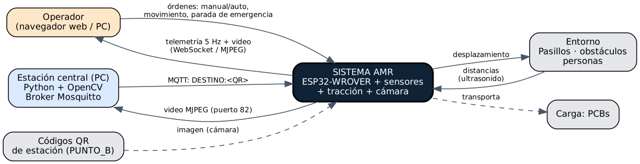

# Documento de Diseño: Robot Móvil Autónomo (AMR) para transporte de PCBs

ESPOL · Ingeniería Mecatrónica · Sistemas Embebidos, Paralelo 102  
Autores: Estefhano Sebastian Jaramillo Granda · 17 Noviembre de 2026

## 1. Introducción
AMR de bajo costo basado en la **Freenove ESP32-WROVER** para transportar PCBs entre estaciones sin líneas guía. Evita obstáculos con 3 sensores ultrasónicos, se guía por códigos QR (OpenCV + MQTT) y se supervisa desde un panel web.

## 2. Alcance y limitaciones
**Incluido:** tracción diferencial (TB6612FNG + PCF8574 + PCA9685), 3 HC-SR04 con freno y evasión autónoma, AP Wi-Fi, panel web (video, telemetría, manual/autónomo, parada de emergencia), visión QR en PC y parada en `PUNTO_B` por MQTT, telemetría de temperatura de la IMU, servo de cámara.

**No incluido / pendiente:** mapeo o planificación global; uso de la IMU en el control (corrección de Yaw y alarma de impactos); sensores traseros; detección de carga; BMS y carga automática; operación sin PC.

## 3. Diagrama de contexto

El operador envía órdenes y recibe video y telemetría; la estación central lee los QR y responde por MQTT; el entorno se percibe con ultrasonido y cámara.

## 4. Diagrama de bloques

| Bloque | Función |
|---|---|
| ESP32-WROVER | Lazo de control a 50 Hz, servidor web/WebSocket, tarea MQTT (núcleo 0), PSRAM de 4 MB para fotogramas |
| PCF8574 | Dirección de motores (P0–P3) y TRIG de sensores (P4–P6) |
| PCA9685 | PWM de motores (canales 0–1) y servo (canal 2) |
| HC-SR04 ×3 | Distancia; ECHO en GPIO 32/33/15 con divisor 1 kΩ/2 kΩ |
| MPU-6050 | Acelerómetro y giroscopio (0x68) |
| TB6612FNG + LM2596 | Puente H con VM directa de la LiPo 2S; 5 V para la lógica |

## 5. Máquina de estados

Prioridad por ciclo (50 Hz, sin `delay()`): (1) `META PUNTO_B` / `PARADA DE EMERGENCIA`; (2) autónomo: `AVANZANDO` → `FRENO` (frontal < 40 cm, 150 ms) → `ESQUIVANDO` (hasta ≥ 55 cm; 380–950 ms); (3) manual con bloqueo de avance < 20 cm y watchdog (600 ms sin orden / 1,5 s sin latido).

## 6. Interfaces
| Interfaz | Medio | Contenido |
|---|---|---|
| ESP32 ↔ periféricos | I2C 100 kHz (SDA 13, SCL 14) | PCF8574, PCA9685 (0x40), MPU-6050 (0x68) |
| HC-SR04 → ESP32 | ECHO GPIO 32/33/15 (ISR); TRIG por PCF8574 | Pulso de 10 µs, filtro y descarte fuera de 2–400 cm |
| Operador ↔ AMR | HTTP :80 + WebSocket `/ws` (JSON) | `hb`, `mode`, `move` (F/B/L/R/S), `estop`; telemetría cada 200 ms |
| Video | MJPEG :81 (panel) y :82 (OpenCV) | AP `AMR_ROBOT_CAM`, 192.168.4.1 |
| PC ↔ ESP32 | MQTT, Mosquitto 192.168.4.2:1883 | Tema `amr/comandos/movimiento`, mensaje `DESTINO:<QR>` |

## 7. Alternativas de diseño
| Decisión | Alternativas | Elegida y justificación |
|---|---|---|
| Percepción | LiDAR; seguimiento de línea | 3 ultrasónicos + QR: bajo costo, sin modificar el piso |
| Visión | En el ESP32; en la PC | PC con OpenCV: el decodificado QR es muy exigente para el ESP32 |
| Pines | GPIO directos; expansores I2C | PCF8574 + PCA9685: la cámara y la PSRAM dejan pocos GPIO |
| Driver | L298N; TB6612FNG | TB6612FNG: MOSFET, sin caída de ≈ 2 V |
| Red | Wi-Fi de infraestructura; HTTP | AP propio + MQTT + WebSocket |
| Control | `delay()`; estados no bloqueantes | Máquina de estados con `millis()` |
| Placa | ESP32 genérica | `freenove_esp32_wrover`: evita bloqueo QIO/DIO y activa PSRAM |

## 8. Plan de test y validación
| Prueba | Procedimiento | Criterio |
|---|---|---|
| Unitarias | Modos de prueba de `main.cpp`, escaneo I2C | Se detectan 0x68, 0x40 y el PCF8574 |
| PSRAM | Reporte serial a 115200 | 4 MB, sin reinicios |
| Precisión ultrasónica | 20, 40, 100, 200 cm con flexómetro | Error ≤ 2 cm |
| Frenado y evasión | Obstáculos frontales/laterales, 10 repeticiones | Sin contacto; esquiva ≥ 9/10 |
| Pérdida de enlace | Cerrar el panel; parada de emergencia | Motores en 0 en < 1,5 s |
| QR y MQTT | `qr_punto_b.png` y otro QR | `PUNTO_B` detiene; otro solo se registra |
| Energía | 15 min con motores y cámara | Sin reinicios; 5,0 V estables |

## 9. Consideraciones éticas
- **Seguridad de las personas:** velocidad limitada, freno por distancia, parada de emergencia, watchdog, supervisión y sensor trasero antes de usar marcha atrás.
- **Privacidad:** no grabar, señalizar la cámara, restringir el flujo de video.
- **Ciberseguridad:** cambiar la clave del AP, autenticar Mosquitto y agregar token a las órdenes.
- **Impacto laboral y ambiental:** reasignar personal; carga y reciclaje seguros de la LiPo.

## Interacciones con otro grupo
| Grupo / fecha | Comentario | Respuesta / cambio | Sección |
|---|---|---|---|
|  |  |  |  |
